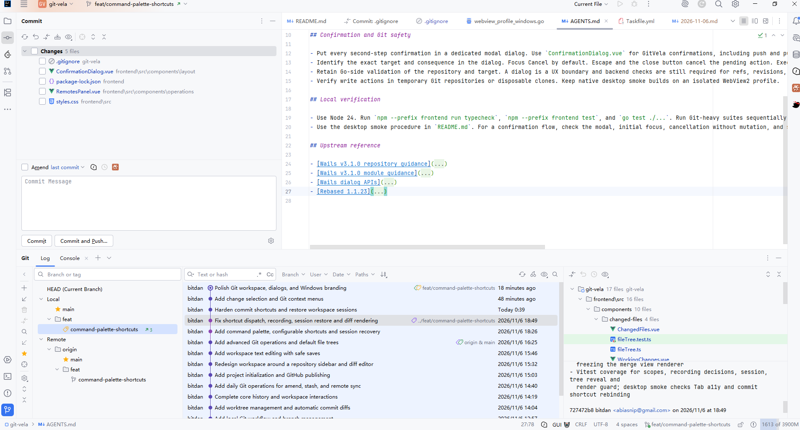

# GitVela — IntelliJ IDEA 风格 Git 客户端最终 UI/UX 规范

> **文档状态**：最终布局基准（后续交互可持续完善）  
> **目标项目**：`F:\project\git-vela`  
> **技术栈**：Wails 3 + Vue 3 + TypeScript + Go  
> **布局基准**：用户提供的 IDEA 风格工作区截图 `docs/reference/idea-git-layout.png`（1907 × 1027）  
> **行为/源码参考**：IntelliJ IDEA（目标产品）与 [DetachHead/rebased](https://github.com/DetachHead/rebased)（基于 IntelliJ Platform 的源码参考） , 本地在 `F:\project\rebased` 
> **适用范围**：窗口组织、Commit 工具窗口、Editor、Git Log、Branches、Changed Files、Diff、交互联动、状态管理及验收。

---

## 0. 最高优先级：不得误解的产品要求

**GitVela 要还原 IntelliJ IDEA 的 Git 工作区，最终布局以本文件附带的用户截图为准。** 不能把当前任意实现视为不可变的规范，也不能因为 Rebased 的默认 Git Log 位于主编辑区就变更本截图布局。

必须同时成立：

1. **左上：Commit 工具窗口**。左侧窗口不是默认 Project 文件树，也不是一个“Changes / Files / Branches / Worktrees”四合一选项卡。
2. **右上：Editor（多标签页）**。用于普通文件、Diff、冲突解决和其他工作内容。
3. **下方：Git 工具窗口横向展开**。在工具窗口内依次组织 **Branches → Commits/Graph → Changed Files / Commit Details**。这不是一个简单的独立底部 Git Log 列表。
4. **最左侧：IDEA 风格 Activity / Tool Window Bar**。用于切换 Project、Commit、Git 等工具窗口；底部 Git 内部可有独立的操作工具条。
5. **顶部：紧凑的主工具栏与标签区域**；**底部：状态栏**。
6. 所有面板支持合理的拖拽调节、显隐、焦点导航和布局保存。**默认布局必须与截图的结构一致**。
7. **IDEA 是视觉和行为标准；Rebased 是源码研究材料；GitVela 是 Wails/Vue/Go 的独立实现。** 不引入 IntelliJ 运行时，也不能照搬不符合许可要求的源码、图标、品牌资源。

如文字与参考截图发生冲突：**截图决定默认布局，实际目标 IDEA 版本决定交互细节；无法确认的行为先标注待验证，不得凭空设计。**

## 1. 视觉基准与区域示意



```text
┌─────────────────────────────────────────────────────────────────────────────────────────────────────┐
│ 顶部工具栏：应用 / 仓库 / 当前分支 / 全局操作 / 搜索 / 设置                                           │
├───┬──────────────────────────────────────┬──────────────────────────────────────────────────────────┤
│ A │ B  Commit Tool Window               │ C  Editor Workspace                                      │
│ c │ ┌──────────────────────────────────┐ │ ┌──────────────────────────────────────────────────────┐ │
│ t │ │ Changes（工作区待提交文件）       │ │ │ 文件标签: README / Diff / AGENTS / Taskfile          │ │
│ i │ │ ☑ file1  ☑ file2  ...            │ │ ├──────────────────────────────────────────────────────┤ │
│ v │ │                                  │ │ │                                                      │ │
│ i │ │                                  │ │ │ 文件正文 / 代码编辑 / Side-by-side Diff             │ │
│ t │ ├──────────────────────────────────┤ │ │                                                      │ │
│ y │ │ Amend / 提交信息                 │ │ │                                                      │ │
│   │ │ [ Commit Message ... ]           │ │ │                                                      │ │
│ B │ │ [Commit] [Commit and Push]       │ │ └──────────────────────────────────────────────────────┘ │
│ a ├──────────────────────────────────────┴──────────────────────────────────────────────────────────┤
│ r │ D  Git Tool Window  [Git] [Log] [Console] ...                                                    │
│   │ ┌────┬───────────────────────┬───────────────────────────────────────┬─────────────────────────┐ │
│   │ │操作│ E  Branches           │ F  Commits / Graph                    │ G  Changed Files        │ │
│   │ │工具│ Local / Remote        │ Graph + Message + Author + Date       │ 文件树（按历史提交）     │ │
│   │ │条  │ 搜索、分支树          │ 筛选、搜索、选择、右键菜单             ├─────────────────────────┤ │
│   │ │    │                       │                                       │ H  Commit Details       │ │
│   │ │    │                       │                                       │ 作者、hash、消息等      │ │
├───┴─┴───────────────────────┴───────────────────────────────────────┴─────────────────────────┤
│ I 状态栏：仓库、分支、Git 操作、文件编码、行号、后台任务状态                                          │
└─────────────────────────────────────────────────────────────────────────────────────────────────────┘
```

### 1.1 默认尺寸基准（截图测量的近似值，并非固定像素）

参考图分辨率 **1907 × 1027**。截图包含应用自身与平台窗口装饰，其像素只是第一轮校准锚点，不得硬编码为所有分辨率的尺寸。

| 区域 | 截图中的位置 / 近似尺寸 | 默认要求 |
|---|---|---|
| 顶部工具栏 | 顶部约 30 px | 单行紧凑；当前仓库、分支明显可见 |
| 最左侧工具栏 | 左侧约 38 px | 竖向窄图标栏，始终可发现 |
| Commit 工具窗口 | 左上约 630 px 宽 | 当前工作区 Changes 在上；提交信息与操作固定在下 |
| Editor | 右上，占剩余主空间 | 顶部多标签栏，内容可滚动，支持 Diff 与普通编辑 |
| 上下区域分界线 | 画面高度约 58% 处 | 可拖动；水平分隔贯穿 Commit 与 Editor 下方 |
| 底部 Git 工具窗口 | 约占窗口下部 40% | 横向覆盖主工作区，**并非只位于 Editor 的底部** |
| Git 左侧 Branches | 底部内容区约 20% | 可缩放/隐藏、含分支搜索、Local/Remote 树 |
| Git 中间 Commits | 底部内容区约 50% | 最宽，承担 Graph/历史记录及过滤 |
| Git 右侧变更/详情 | 底部内容区约 30% | 上 Changed Files、下 Commit Details，可调整分隔比例 |
| 底部状态栏 | 最底部约 25–30 px | 不覆盖编辑区或工具窗口 |

交互最低窗口尺寸应按实际使用验证，不通过无意义地缩小文字掩盖空间问题。窗口变窄时优先允许折叠/隐藏工具窗口，而不是交换原本的布局层级。

## 2. 整体窗口与组件职责

### 2.1 顶部 Main Toolbar

- 左侧：应用入口、主菜单、仓库标识/名称、当前分支及分支切换入口。
- 右侧：当前上下文操作、全局搜索、设置、窗口相关按钮。
- 当前分支名称、dirty 状态、进行中的 Git 操作应准确刷新，不得只显示静态标签。
- 普通按钮有统一 hover、focus、disabled、tooltip；键盘访问与菜单行为参考 IDEA。

### 2.2 左侧 Activity Bar

- 采用 IDEA 式纵向工具窗口入口，而非将所有业务页面全部塞到一组水平标签中。
- 入口可以包括 Project、Commit、Git、Branches / Worktrees 等；实际可见和排序以目标 IDEA 界面与产品范围确认。
- 点击入口切换或显示对应 Tool Window，保留原窗口的滚动位置、选中项及宽度。
- Commit 工具窗口默认打开在左上；Git 工具窗口默认打开在底部。
- 工具栏图标与窗口标题语义一致，提供 tooltip 和无障碍名称。

### 2.3 左上 Commit Tool Window（工作区提交区）

截图中左上区域包含：

1. 标题 `Commit`、窗口操作区。
2. Changes 文件树：按文件夹分组，显示改动状态、文件名与相对路径；支持多选、过滤、展开/折叠。
3. 每文件左侧用于控制此次提交纳入范围的勾选操作，具体实现应明确映射 GitVela 的 Git index/stage 语义，**不能未经分析就把 IDEA 的勾选含义等同于简单的前端选中状态**。
4. Changes 面板底部显示 Amend 等提交选项与对应安全提醒。
5. 提交信息编辑区固定在底部，文件列表扩展时不会把提交按钮挤出窗口。
6. `Commit` 与 `Commit and Push` 分开；Push 的远程与目标分支确认须遵守安全检查。

**行为要求**：选择 Changes 中的文件更新本地文件上下文；通过 IDEA 对应操作入口打开 Diff；不改变下方 Git Log 已选中的历史提交。提交成功后正确刷新 Working Changes、分支 HEAD 与 Git Log，提交失败不清除用户消息和当前选择。

### 2.4 右上 Editor Workspace

- 顶部可同时显示多个文件/编辑/Diff 标签，支持关闭、恢复焦点、切换。
- 标签区域和正文独立，不因 Commit/Log 的异步刷新无故重建编辑器。
- 普通文件编辑保持未保存修改的提示与安全保护；跳转仓库、关闭标签、切换文件时不静默丢失内容。
- IDEA 对齐项：文件图标、修改标记、活动标签、键盘导航、文本搜索、复制、行号、滚动位置等。
- Diff 内容应在 Editor 打开对应标签页（或 IDEA 的明确预览模式），不是单击历史提交就始终抢占整个主编辑区。
- 支持 Side-by-side / Unified、Hunk 导航、大文件保护、二进制/图片/子模块降级显示。

### 2.5 底部 Git Tool Window

底部 Git 工具窗口采用可伸缩横向分区，不是独立全屏历史页。

- **窗口级**：Git / Log / Console 等标签、最大化/恢复、隐藏、独立操作工具条。
- **E：Branches**：分支/标签搜索，HEAD、Local、Remote 分组，分支树选择与右键操作；可折叠。
- **F：Commits / Graph**：图形轨道、提交摘要、标签、作者、时间、搜索和过滤。底部主工作区的核心列表。
- **G：Changed Files**：随当前历史提交变化，显示该提交对应文件树；支持 Diff 操作。
- **H：Commit Details**：提交哈希、作者、提交日期、主题、正文、父提交、refs；如有足够空间显示更完整信息。
- E/F/G/H 的数据是统一 Log selection 的不同投影，必须通过中心化状态保证一致，并处理异步请求竞态。
- 底部主窗口可隐藏或最大化，但恢复后保留原有尺寸、滚动和选择。

### 2.6 状态栏

- 仓库路径/名称、当前分支与 Git 工作区状态、正在运行的操作进度和结果。
- Editor 可显示换行符、编码、当前行列信息；消息不过度打断编辑。
- 错误信息可追溯，危险或失败操作应有清晰的后续处理入口。

## 3. 两类文件变更必须严格分离

| 维度 | 左上 Commit → Changes | 下方 Git Log → Changed Files |
|---|---|---|
| 数据来源 | 当前工作树、Index、未跟踪文件 | 当前选中历史提交（或选择的提交范围） |
| 使用目的 | 组织此次提交、暂存/纳入范围、提交 | 查看历史提交改动、比对两个版本 |
| 选中后 | 更新工作区当前文件上下文 | 更新历史提交文件上下文 |
| Diff 数据 | 工作区 / Index / HEAD | 选中提交与其父提交或两个历史版本 |
| 是否可直接提交 | 可通过 Commit 窗口流程提交 | 不能把历史文件列表当做当前工作区暂存区 |
| 独立状态 | `workingSelection`, `commitMessage`, `includedFiles` 等 | `selectedCommit`, `selectedHistoryFile`, `comparisonRange` 等 |

两个面板可复用底层树视图/状态徽标/菜单组件，但**禁止共享会导致相互覆盖的选中状态**。

## 4. 必须复现的交互协议

### 4.1 Git Log / Graph

1. **单击历史提交**：中间行高亮 → 右侧 Changed Files 和 Commit Details 更新；中央 Editor 的既有标签、未保存内容、当前焦点不强制改变。
2. **双击历史文件**：在 Editor 打开该文件相对于提交父节点的 Diff；目标 IDEA 实际行为若不同，以实测修订。
3. **右键提交**：在光标处打开上下文菜单；可用/不可用操作依赖选中提交数量、是否 HEAD、是否合并提交、仓库正在运行的 Git 操作等。
4. **Ctrl/Shift 多选提交**：列表正确保持多选；仅当存在合法比较目标时允许比较操作，绝不默默执行 Reset/Rebase。
5. **Graph 节点与边**：节点、分支标签和整行的命中区域、hover、高亮、工具提示与鼠标语义应对应 IDEA；Canvas 不应只有视觉呈现却无法实现相关交互。
6. **筛选**：Branch / User / Date / Paths / Text / Hash 等；刷新或重新搜索时保留合理的滚动位置和已选状态，避免错误闪烁。
7. **键盘**：Up/Down 切换行，PageUp/PageDown 浏览；焦点在搜索框和 Editor 时不劫持输入。快捷键自定义仍遵守作用域。

### 4.2 Branches

- 单击分支主要改变选择和历史过滤上下文；不将“选择”误实现为“Checkout”。
- Checkout、Create Branch、Merge、Rebase、Delete、Push 等操作采用 IDEA 风格的上下文入口。
- 修改仓库的操作必须明确当前仓库、源分支、目标分支和风险；二次确认通过专用对话框实现，Esc 取消。
- Local / Remote / HEAD 显示准确，远程分支名称和 tracking 关系不混淆。

### 4.3 Commit Tool Window

- 选中/勾选、Stage/Unstage 与包含在提交中的文件状态必须同步，并有明确数据语义。
- 点击提交前核对提交信息、可提交文件及后台忙状态。
- 输入框中的普通字符、Enter、方向键等绝不可被错误解析为 Git 写操作快捷键。
- `Commit and Push` 的行为是提交成功后再进入 Push 流程；Push 失败不得假装本地 Commit 也失败。
- Amend、Reset、Rebase、Discard 等高风险行为需要范围明确的确认与取消处理。

### 4.4 Editor 与 Diff

- 打开新 Diff 标签不破坏当前普通文件编辑标签。
- 提交变化和文件选中异步读取期间，快速切换项只显示最后一次有效请求结果。
- 编辑器自行处理自己的 Ctrl+F、Ctrl+Enter 等键，避免全局热键双重分发。
- 区分历史 Diff、Staged Diff、Unstaged Diff、Working File 和冲突解决视图。
- 文件大、单行过长、图片、二进制、LFS、子模块等有明确降级或可控加载策略。

### 4.5 拖拽布局与会话恢复

- 支持 Commit 宽度、Git 总高度、Git 内部 Branches/Commits/Changed Files 宽度及右侧上下比例的调整。
- 最小宽度应保证标题、操作按钮和必要内容可用；不会拖出负尺寸或产生无限布局递归。
- 启动恢复仓库、Tool Window 显隐、当前 Editor 标签、Git Log 选择、当前工作文件、布局尺寸及分支过滤状态。
- 不把 `selectedCommit.hash` 的存在当成应该打开历史 Diff 的理由；严格依照上次活跃视图恢复。

## 5. 样式与可用性边界

1. 视觉风格保持 IDEA New UI 的密度、分隔线、图标尺寸、背景层级、选中与悬停，而不是另行设计“大圆角卡片式 Dashboard”。
2. 参考截图中的浅色主题；暗色主题保持同一布局规则与信息层级。
3. 颜色、间距、行高应建立语义 CSS Token（例如 `--tool-window-width`、`--git-log-height`、`--border`、`--selection`），不要在多个组件重复写魔法数。
4. 选中状态、聚焦状态、悬停状态分别可辨识；不能只靠颜色传达 Git 文件状态。
5. 左侧工具条和右侧辅助工具条不应与中央正文滚动冲突。
6. 对滚动密集区域优先使用虚拟化列表；尺寸估值必须与真实 CSS 行高一致。
7. 不因修复 UI 而把所有行为集中回 `App.vue`；可抽出 Dock、Editor Tabs、Git Log Pane、Commit Tool Window 状态与组件。
8. 对 Rebased/IDEA 源码只借鉴可合法复现的行为与架构；品牌标识、图标、受许可限制的资源须替换为自己的实现。

## 6. 建议的 Vue 组件边界（不是强制重命名）

```text
AppShell
├─ MainToolbar
├─ ActivityBar
├─ UpperWorkspace                 ← 左上/右上平铺
│  ├─ CommitToolWindow             ← 当前工作区 Changes + Commit
│  │  ├─ WorkingChanges
│  │  └─ CommitForm
│  └─ EditorWorkspace
│     ├─ EditorTabs
│     ├─ WorkspaceEditor
│     ├─ TextDiff
│     └─ ConflictPanel
├─ GitToolWindow                  ← 下方横向占整个工作区
│  ├─ GitToolWindowTabs
│  ├─ GitActionToolbar
│  └─ GitLogView
│     ├─ BranchesPanel
│     ├─ CommitLog                 ← GraphCell + 虚拟历史列表
│     └─ GitLogRightPanel
│        ├─ ChangedFiles
│        └─ CommitDetails
└─ StatusBar
```

现有代码可优先复用（需按 GitVela 最新提交再次核对）：

| GitVela 现有位置 | 新布局目标 | 注意事项 |
|---|---|---|
| `frontend/src/App.vue` | AppShell/布局与状态协调 | 逐步拆分，不再集中承担全部面板渲染与 Git 写操作 |
| `frontend/src/styles.css` | 全局 Token、Dock/布局层 | 先实现截图的整体几何结构，再微调配色 |
| `frontend/src/components/changed-files/WorkingChanges.vue` | 左上 Commit 工具窗口 | 保留 Commit 流程安全与真实 Index 语义 |
| `frontend/src/components/git-log/CommitLog.vue` | 下方 Git 中央历史列表 | 多选、右键菜单、过滤、Graph 交互 |
| `frontend/src/components/git-log/GraphCell.vue` | Git Log Graph | 对应节点与标签交互，不止静态 Canvas |
| `frontend/src/components/changed-files/ChangedFiles.vue` | 下方 Git 右侧历史文件树 | 不与 Working Changes 混用选择状态 |
| `frontend/src/components/diff/TextDiff.vue` | Editor 中的 Diff 标签页 | 多标签、焦点和虚拟化/性能保护 |
| `frontend/src/stores/workspace.ts` | Git 历史与工作区状态 | 异步请求防竞态，选中状态隔离 |

### 6.1 Rebased 源码入口（研究交互，不照搬其默认布局）

- `platform/vcs-log/impl/src/com/intellij/vcs/log/ui/frame/MainFrame.java`：Graph、Changed Files、Details、Diff 的组件组合及监听。
- `platform/vcs-log/impl/src/com/intellij/vcs/log/ui/table/VcsLogGraphTable.java`：提交列表、选择、hover、列及鼠标行为。
- `platform/vcs-log/impl/src/com/intellij/vcs/log/ui/table/GraphCommitCellController.java`：提交图交互。
- `platform/vcs-log/impl/src/com/intellij/vcs/log/ui/frame/VcsLogChangesBrowser.kt`：历史 Changed Files 与 Diff。
- `platform/vcs-log/impl/src/com/intellij/vcs/log/ui/frame/FrameDiffPreview.kt`：Diff 显隐、方向与状态。
- `platform/vcs-log/impl/src/com/intellij/vcs/log/ui/actions/`：历史提交相关操作。
- `plugins/git4idea/`、`platform/vcs-impl/`：Git 业务交互、文件变更及工具窗口关联的代码。

**重要**：上述路径是入口，并不代表每项交互已在该文件中得到完全证实。Codex 必须追踪具体事件、状态和调用链，报告真实证据。

## 7. 截图对照与验收清单

### 7.1 视觉验收

- [ ] 左上是 **Commit Tool Window**，而非默认 Project 侧边栏。
- [ ] 右上是 **Editor**，可同时打开多个文件标签。
- [ ] 下方是一个横向完整的 **Git Tool Window**，不是只有右侧 Editor 下方的 History。
- [ ] 底部 Git 内有左 Branches、中 Commit Graph、右 Changed Files / Commit Details。
- [ ] Commit 的文件列表上方、提交信息下方的分区关系与截图一致。
- [ ] Git Log 中央区域具有更高的信息密度，显示 Graph / Message / 作者 / 时间等。
- [ ] 底部 Git 的右侧 Changed Files 上下结构与截图一致。
- [ ] 面板分隔线、工具栏高度、行密度、边框、hover 和 selection 与基准图做同尺寸对照。
- [ ] 深色模式遵守相同的结构。

### 7.2 交互验收（至少覆盖以下场景）

| ID | 操作 | 可观察结果 |
|---|---|---|
| T01 | 打开测试仓库 | 默认出现 Commit 左上、Editor 右上、Git 下方的布局 |
| T02 | 单击 Git Log 某个 Commit | 底部右侧历史文件树和详情改变，Editor 内容不被强制替换 |
| T03 | 双击历史 Changed Files 的文件 | Editor 新增/切换到对应历史 Diff 标签 |
| T04 | 回到 Editor 原文件标签 | 未保存内容和滚动位置仍在 |
| T05 | 右键 Commit 行 | 正确上下文菜单出现，操作启用/禁用合理 |
| T06 | Ctrl/Shift 多选 Commit | 选择范围正确，不触发危险写操作 |
| T07 | 点击分支树某分支 | 选择或过滤符合 IDEA 语义，不会擅自 Checkout |
| T08 | 右键分支并 Checkout | 正确目标校验与写操作状态反馈 |
| T09 | 在左上 Changes 勾选文件 | 纳入提交范围的状态准确反映 Git index/业务语义 |
| T10 | 输入提交信息并 Commit | 只提交预期内容；Git Log 与工作树刷新 |
| T11 | Commit and Push | 区分本地提交成功与远程 Push 结果 |
| T12 | 在提交信息输入普通字符 | 不触发快捷键导致误提交 |
| T13 | Editor 使用 Ctrl+F | 仅打开编辑器搜索，不同时启动历史搜索 |
| T14 | 快速点击不同提交或文件 | 异步响应不会把旧结果覆盖到新选择上 |
| T15 | 调整多个 Splitter 并重启 | 所有面板宽高、显隐、选中状态在合理范围恢复 |
| T16 | 切换 Git 窗口显示/隐藏及最大化 | Editor 能正确伸缩；恢复原布局 |
| T17 | 展开大型仓库/历史 Diff | 虚拟列表性能稳定，超大文件合理降级 |
| T18 | 执行 Rebase/Reset/Discard 等危险操作 | 目标明确、确认可取消、无隐式数据损失 |

### 7.3 验收环境

- 使用用户提供的截图 `docs/reference/idea-git-layout.png` 作为 **S0 布局基准**。
- 优先在 1907 × 1027 的截图尺寸对应显示环境下对比；另测 1440 × 900（控制系统缩放和 Wails 窗口装饰差异）。
- 使用同一临时 Git 仓库、同样的文件数与提交历史，以便进行视觉/交互比对。
- 对每个核心状态保留 IDEA（或用户指定参考图）与 GitVela 的截图及差异说明。
- 源码测试之外要运行真实 Windows WebView2 桌面冒烟测试。无法运行时要明确标记“未验证”，不能宣称通过。

## 8. 实施顺序与阶段交付

### 阶段 A — 实际对照，不修改实现

1. 读取本文件和用户截图；识别所有固定布局规则。
2. 检查 GitVela 最新代码，对照 S0 截图核对差异。
3. 读取 Rebased 核心源码，建立 **IDEA 行为 → Rebased 源码 → GitVela 组件/API** 映射。
4. 输出 `docs/idea-gap-analysis.md`，必须指出证据、所需改动文件、影响面和验收方式。
5. 对 IDEA 不同版本的细节差异单独列出，禁止无证据地以 Rebased 默认布局覆盖 S0。

### 阶段 B — 布局骨架与工具窗口

- 构建/调整 Top Toolbar、Activity Bar、Commit 左上、Editor 右上、Git 下方、状态栏。
- 拖拽分隔线、最小尺寸、隐藏/最大化、布局保存。
- 截图与 S0 比较通过后才继续其他模块。

### 阶段 C — Git Log 交互

- Branches / Commit Graph / Changed Files / Details 四区联动。
- 右键菜单、多选、节点交互、过滤、快捷键、异步状态。

### 阶段 D — Commit 与 Editor / Diff

- 本地 Changes、提交范围、Commit/Push 流程。
- Editor 多标签、Diff 打开规则、焦点和变更保护。

### 阶段 E — 综合回归与视觉验收

- 用本文件 T01–T18 逐项验证。
- 运行前端 typecheck、前端测试、Go 测试和适用的桌面冒烟测试。
- 在真实 Windows 截图中比较布局；列出残余差异，标记阻塞项和非阻塞项。
- 验收通过前，不将“看起来相似”或“已有功能”视为完成。

## 9. 可以直接发送给 Codex 的执行指令

> 阅读 `docs/idea-ui-final-spec.md`，以 `docs/reference/idea-git-layout.png` 为 **最高优先级的默认界面布局依据**。你要还原的是截图中的 IntelliJ IDEA 风格 Git 工作区：**左上 Commit、右上多标签 Editor、底部横贯工作区的 Git Tool Window（左 Branches、中 Commits/Graph、右 Changed Files/Commit Details）**。不得参考 Rebased 的默认 Log 主视图擅自交换这些区域，也不得将 GitVela 目前任何不一致的布局视为固定设计。先阅读 Rebased 相关源码追踪行为，审计 GitVela 组件和状态流，输出 `docs/idea-gap-analysis.md` 与分阶段实施清单。**本轮先分析与出计划，不改代码、不合并分支**。对无法从源码或截图确认的交互标记为待验证。

---

## 10. 一句话定义完成

**GitVela 应让熟悉 IntelliJ IDEA 的用户打开它时，看到自己熟悉的 Commit + Editor + 底部 Git Log 工作区，并且通过同样的操作路径完成日常 Git 工作；实现技术依然是独立、轻量的 Wails + Vue + Go。**
